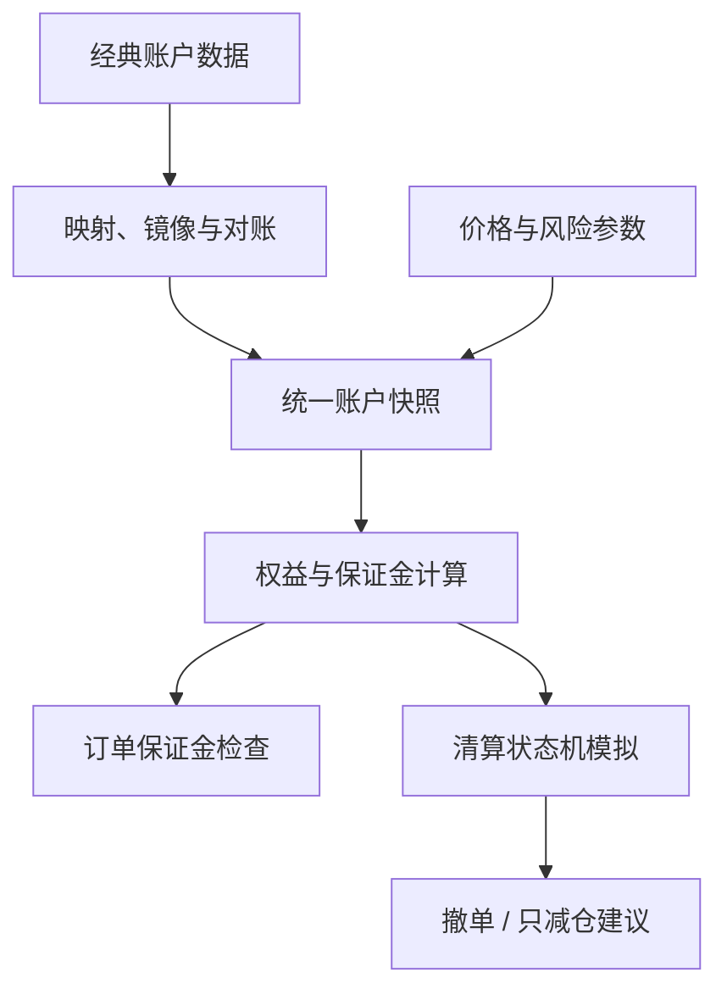

# UTA Reference Exchange

一个开源的统一交易账户（Unified Trading Account，UTA）参考实现，探索如何在既有经典账户之上建立可核对的账户镜像，并把资产、负债、合约持仓纳入共同的保证金检查与清算流程。

> 风险模型是简化的线性保证金模型，并不是任何交易所的实际 Portfolio Margin（PM）规则，也未实现生产级撮合、资金安全、风控或清算系统。

## 核心能力

- **统一账户数据模型**：用 `Decimal` 表示余额、负债、线性合约仓位、标记价格、抵押品折扣和保证金参数。
- **保证金检查**：计算折扣后权益、未实现盈亏、初始及维持保证金、订单占用和可用保证金；通过模拟即时成交评估下单影响。
- **清算流程模拟**：根据风险快照提出撤单与只减仓建议；数据不完整、过期或倒退时阻断；动作确认与去重均在内存中模拟。
- **经典账户镜像**：为经典账户数据映射、同步和对账建立参考流程，支持发现缺失或不一致数据。
- **独立账本与保证金预留示例**：提供按资产平衡的双分录事件重放，以及单进程内带版本检查的线程安全预留。两者均为内存模块，尚未接入订单 API、镜像或风险引擎。

上述功能均是原型。尤其是：当前保证金计算没有场景扫描或资产间风险抵消，因此**不等同于完整 PM 组合保证金引擎**。设计与生产化缺口见 [架构设计](docs/architecture.md) 和 [风险模型及限制](docs/risk-model.md)。

项目当前的明确范围是多币种抵押品和以 USD 为报告单位的线性永续仓位。模型支持分别输入资产总额和负债；两者需要不同折扣时，先净额化会产生不同结果。镜像与风险引擎没有自动连接，也没有验证真实交易所结果。不得将示例结果作为任何账户的实际安全结论。

## 快速开始

需要 Python 3.10 或更新版本；核心代码仅使用 Python 标准库。

```bash
# 运行风险、下单检查和清算建议示例
python -m uta demo

# 运行测试
python -m unittest discover -s tests -v
```

本地 JSON 演示 API：

```bash
python -m uta serve --port 8080
```

另开终端：

```bash
curl http://127.0.0.1:8080/health
curl http://127.0.0.1:8080/sample -o sample.json
curl -X POST http://127.0.0.1:8080/risk -H 'Content-Type: application/json' --data-binary @sample.json
```

`GET /sample` 返回示例账户输入；`POST /risk` 计算风险；`POST /order-check` 使用相同输入，额外提供 `order` 对象来模拟订单。财务数值使用十进制字符串。服务仅供本机演示，**没有身份验证，不应暴露在公网或处理真实敏感数据**。

下面是独立的风险计算示例。数值仅用于解释计算，不代表交易所参数或投资建议。

```python
from decimal import Decimal as D
from uta.models import Account, AssetSpec, InstrumentSpec, Position
from uta.risk import calculate_risk, check_order

account = Account(
    balances={"USDT": D("10000")},
    positions={"BTC-PERP": Position("BTC-PERP", D("0.1"), D("95000"))},
    open_order_margin=D("100"),
)
assets = {"USDT": AssetSpec(price=D("1"), collateral_factor=D("1"))}
instruments = {"BTC-PERP": InstrumentSpec(
    mark_price=D("100000"), initial_margin_rate=D("0.10"),
    maintenance_margin_rate=D("0.05"),
)}

snapshot = calculate_risk(account, assets, instruments)
print(snapshot.equity, snapshot.initial_margin, snapshot.maintenance_margin)
# 权益 10500、初始保证金 1000、维持保证金 500

result = check_order(account, assets, instruments, symbol="BTC-PERP",
                     quantity=D("0.01"), execution_price=D("100000"),
                     fee_rate=D("0.0004"))
print(result.accepted, result.projected_available_margin)
```

输入必须由调用方保证来自新鲜且一致的账户和价格快照。订单检查本身不会原子地预留保证金，也不会提交订单。

## 参考处理流程



这张图展示目标职责；目前镜像输出尚未自动转换为风险引擎输入，调用方需单独完成映射与核对。项目也未接入真实交易所、持久化消息总线或自动下单。

## 开源贡献

欢迎提交 issue、讨论设计与 pull request。涉及风险公式时，请提供假设、数值示例和边界测试；涉及某一交易所的规则时，请链接其官方文档并说明适用版本、地区与账户类型。切勿提交 API 密钥、客户数据或真实订单信息。

验证范围与手算案例见 [验证与证据](docs/verification.md)；贡献流程见 [CONTRIBUTING.md](CONTRIBUTING.md)。
