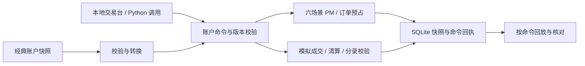

# UTA Reference Exchange

一个可在本地运行和回放的统一交易账户。六场景组合保证金模型覆盖 USD、BTC、ETH 抵押及负债、BTC/ETH 线性永续合约。下单、模拟成交、清算成交和资金分录通过同一账户版本提交到 SQLite。

## 阅读导航

| 文档 | 解决的问题 |
| --- | --- |
| [事务与分片架构](docs/architecture.md) | 模块依赖、账户事务、版本与回执如何一起提交 |
| [关键业务流程](docs/workflows.md) | 经典账户如何导入，下单和清算如何推进，如何捕获一致版本并回放 |
| [本地运行与 API](docs/simulator.md) | 命令格式、状态、错误码与重试方式 |
| [风险模型](docs/risk-model.md) | 六场景 PM、订单预占及旧版固定费率公式的适用范围 |
| [验证与证据](docs/verification.md) | 可复算案例、测试覆盖和未验证的边界 |
| [性能测试](docs/performance.md) | 计算、提交、清算成交的不同计数口径 |
| [有界预占模型](formal/README.md) | 固定容量抽象的状态转换与证明边界 |



图中是当前持久化模拟链路，入口与事务位于 [uta/simulator.py](uta/simulator.py) 和 [uta/store.py](uta/store.py)。每次命令的状态与回执在同一事务内提交；行情与成交由本地操作者提供。

## 运行本地交易台

需要 Python 3.10+，无需安装依赖。

```bash
python -m uta lab --db data.sqlite3 --port 8765
```

打开 [127.0.0.1:8765](http://127.0.0.1:8765)。输入任意新的模拟账户 ID 并创建账户。交易台展示风险权益、IM、MM、订单预占、最坏压力情景、仓位、清算和资金分录。创建同名账户会返回版本冲突，重启后可重新读取已有账户。

部署在单台机器时，也可以用固定的 SHA-256 账户路由分到多个 SQLite WAL 文件。使用新的数据库基名，之后以同样的分片数重开。

```bash
python -m uta lab --db lab-multi.sqlite3 --shards 8
python -m uta scenario --shards 4
python -m uta scenario --db exercise.sqlite3 --account shock-demo
python -m uta replay --db exercise.sqlite3 --account shock-demo
python -m unittest discover -s tests -v
```

`scenario` 自动执行开仓、成交、挂单、行情暴跌、撤单、清算成交，以及重开与审计回放。指定 `--db` 可保留结果。用于后续回放的 `--account` 与 `--shards` 必须和写入时一致。

## 保证金与清算

| 环节 | 实现 |
| --- | --- |
| 经典账户导入 | 按资产合并可用余额，单独保留借款和利息。保留来源账户、版本及哈希。拒绝有未对账冻结资金的快照，新账户使用模拟报价。 |
| 组合保证金 | 六场景同时重估抵押品、负债和持仓，覆盖同向行情、相关性变化及基差。IM 取压力损失与仓位底线的较大值。MM 使用压力损失的 80% 与维持保证金底线。 |
| 下单与预占 | 按每单位最大 IM 变化、限价不利差与费用预占。预占、检查、账户版本与回执同事务提交。 |
| 模拟成交 | 校验挂单剩余数量和限价，使用 FIFO 持仓和精确账面成本，提交实现损益、手续费和双分录。 |
| 清算执行 | 先撤挂单，再比较半仓和全仓减仓后的权益减 MM。清算成交只减仓，残余欠账进入 USD 负债。行情更新与清算可作为一个有界命令提交。 |
| 审计与恢复 | 相同 ID、版本及载荷返回旧回执。在同一读事务捕获账户快照与历史，校验创世记录及后续命令信封，再按原决策时间重放，严格核对回执及快照的 JSON 值与类型；结果标识捕获版本。 |

当前实现运行在本地模拟环境，包含人工提交的行情与成交。六场景参数为项目自定义。实际撮合、市场深度、资金转移、保险基金、ADL、跨主机复制、外部数据校准和多分片事务属于后续范围。完整输入、事务和清算语义见 [本地运行与 API](docs/simulator.md)。

可复跑的压测区分计算、落库订单和落库清算。当前端到端系统的持续万笔/秒目标待验收。基准、延迟、拒绝与积压结果见 [性能测试](docs/performance.md)。

## 独立计算示例与旧版接口

需要 Python 3.10 或更新版本；核心代码仅使用 Python 标准库。

```bash
# 运行风险、下单检查和清算建议示例
python -m uta demo

# 运行测试
python -m unittest discover -s tests -v
```

本地 JSON 演示 API：

```bash
python -m uta serve --port 8080
```

另开终端：

```bash
curl http://127.0.0.1:8080/health
curl http://127.0.0.1:8080/sample -o sample.json
curl -X POST http://127.0.0.1:8080/risk -H 'Content-Type: application/json' --data-binary @sample.json
```

`GET /sample` 返回示例账户输入；`POST /risk` 计算风险；`POST /order-check` 使用相同输入，额外提供 `order` 对象来模拟订单。财务数值使用十进制字符串。服务仅供本机演示，**没有身份验证，不应暴露在公网或处理真实敏感数据**。

下面是独立的风险计算示例。数值仅用于解释计算，不代表交易所参数或投资建议。

```python
from decimal import Decimal as D
from uta.models import Account, AssetSpec, InstrumentSpec, Position
from uta.risk import calculate_risk, check_order

account = Account(
    balances={"USDT": D("10000")},
    positions={"BTC-PERP": Position("BTC-PERP", D("0.1"), D("95000"))},
    open_order_margin=D("100"),
)
assets = {"USDT": AssetSpec(price=D("1"), collateral_factor=D("1"))}
instruments = {"BTC-PERP": InstrumentSpec(
    mark_price=D("100000"), initial_margin_rate=D("0.10"),
    maintenance_margin_rate=D("0.05"),
)}

snapshot = calculate_risk(account, assets, instruments)
print(snapshot.equity, snapshot.initial_margin, snapshot.maintenance_margin)
# 权益 10500、初始保证金 1000、维持保证金 500

result = check_order(account, assets, instruments, symbol="BTC-PERP",
                     quantity=D("0.01"), execution_price=D("100000"),
                     fee_rate=D("0.0004"))
print(result.accepted, result.projected_available_margin)
```

输入必须由调用方保证来自新鲜且一致的账户和价格快照。订单检查本身不会原子地预留保证金，也不会提交订单。

## 开源贡献

欢迎提交 issue、讨论设计与 pull request。涉及风险公式时，请提供假设、数值示例和边界测试；涉及某一交易所的规则时，请链接其官方文档并说明适用版本、地区与账户类型。切勿提交 API 密钥、客户数据或真实订单信息。

验证范围与手算案例见 [验证与证据](docs/verification.md)；贡献流程见 [CONTRIBUTING.md](CONTRIBUTING.md)。
