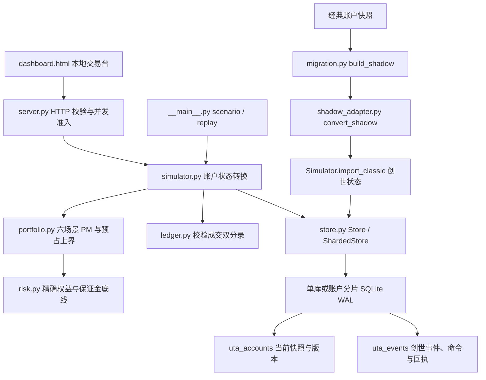
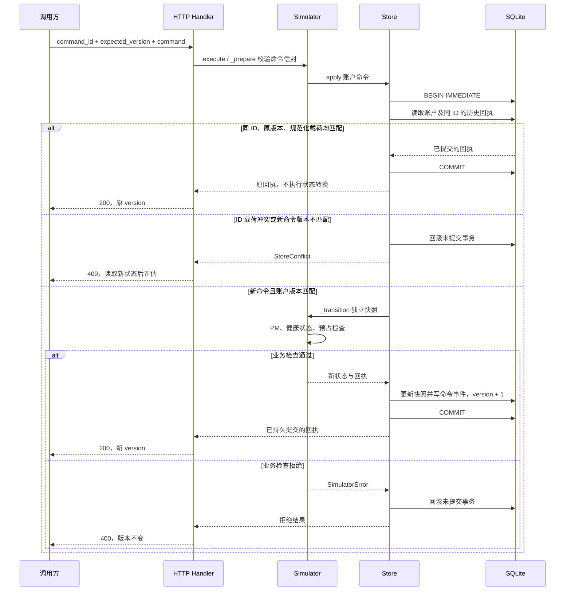
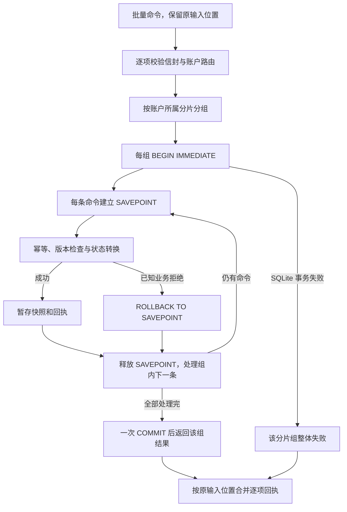

# UTA 事务与分片架构

当前主链路是单机持久化交易模拟器。经典账户导入建立版本 0 的创世状态；后续余额、仓位、订单和行情的变更都通过带版本的账户命令提交。旧版固定费率 API、内存清算控制器和独立预留簿仍可单独运行，不能把它们的行为直接套用到模拟器。

## 模块与调用边界

`import_classic` 先校验与转换，再调用 `Store.create`；图中的导入路径不执行持续同步。`Ledger` 在 `_trade` 中校验分录，分录随命令回执保存为事件 JSON，没有独立的持久化总账表。账户读回与回放也通过 `Simulator` 和存储层进行。

独立内存日记簿的 `Ledger.replay(scales, events, unit_digits=...)` 使用调用方保留的币种小数位和整数单位位数上限重建余额及幂等索引；默认上限为 38 位，较宽历史须显式提供原配置。精确回放示例与范围测试见 [验证说明](verification.md)。

| 模块 | 当前职责 | 源码入口 |
| --- | --- | --- |
| HTTP 与交易台 | 本机监听、请求形状、同源校验、64 KiB 请求体与并发上限 | [server.py](../uta/server.py)、[dashboard.html](../uta/dashboard.html) |
| 经典账户导入 | 完整字段与时间校验，保留来源摘要，拒绝不支持的产品及非零冻结余额 | [migration.py](../uta/migration.py)、[shadow_adapter.py](../uta/shadow_adapter.py) |
| 账户命令 | 下单、FIFO 成交、行情更新、撤单、模拟清算与回放 | [Simulator._transition](../uta/simulator.py) |
| 组合风险 | 六场景联合重估、IM/MM 底线与订单 IM 变化上界 | [portfolio.py](../uta/portfolio.py)、[risk.py](../uta/risk.py) |
| 分录校验 | 每种资产分别平衡，成交损益和费用生成对手科目 | [Ledger.post](../uta/ledger.py)、[模拟成交](../uta/simulator.py) |
| 事务与路由 | 账户版本、快照与回执原子提交；按账户固定路由 | [Store._apply / ShardedStore](../uta/store.py) |

## 单条命令的事务时序

下图以 HTTP 下单为例。成交命令在相同事务位置调用 `_trade`，校验 FIFO 成本和分录。它们都不在事务内调用外部交易所。

实现依据：[Simulator.execute / _prepare / _transition](../uta/simulator.py)，[Store.apply / _apply / _transaction](../uta/store.py)，[HTTP 错误映射](../uta/server.py)。数据库异常会使本次事务失败，HTTP 返回 503；响应丢失时不能据此判断命令未提交，须用原请求重试。已提交回执的查找先于当前版本比较，所以旧命令可在账户版本继续推进后恢复原结果。业务拒绝不写入成功事件。

## 批量提交与账户分片

`Simulator` 在 `shards=1` 时使用单个 `Store`；`shards=2..64` 时使用 `ShardedStore`。路由为 `int(SHA256(account_id), 16) % shards`，记录在分片目录的 `manifest.sqlite3` 中。分片数和路由在首次创建后固定；重开必须提供相同配置，不支持在线重新分片。

图中 SQLite 失败分支代表整个分片事务期间的数据库错误，包括提交失败。单库或同一分片内按输入顺序处理；分片组可并行提交，最多使用 8 个组工作线程。一个分片失败不会回滚其他分片，批量接口没有跨分片的全局原子性。实现与故障测试分别见 [Store.apply_many / ShardedStore.apply_many](../uta/store.py)、[test_store.py](../tests/test_store.py)。

## 独立示例与生产化边界

| 路径 | 状态与职责 |
| --- | --- |
| `lab`、`scenario`、`replay` | SQLite 持久化模拟主链路，使用六场景 PM |
| `serve` / `uta.api` | 固定费率无状态计算，未接入账户事务 |
| `LiquidationController` | 内存动作提议与确认，默认恢复缓冲为 1.10 倍 MM；不负责模拟器清算成交 |
| `ReservationBook` | 单进程独立预留簿，未用于持久化模拟器的下单路径 |
| `ShadowMigrationStore` | 只读镜像的独立内存版本与幂等示例，不是持续导入服务 |

主链路的导入、清算和审计回放见 [关键业务流程](workflows.md)；输入与重试见 [本地运行与 API](simulator.md)。系统没有真实撮合、资金转移、外部行情认证、多副本共识或跨主机故障恢复。扩容仍需账户写入所有权、热账户与清算队列、行情版本扇出、分片迁移和端到端持续负载验收；当前证据见 [性能测试](performance.md) 与 [验证范围](verification.md)。
