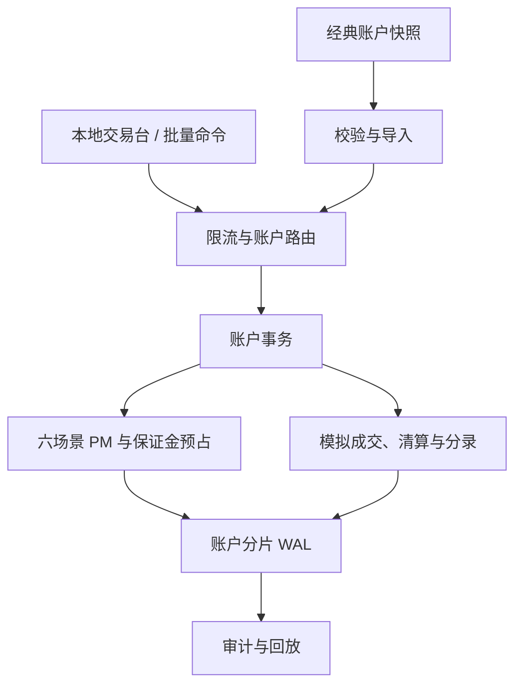

# UTA 事务与分片架构

经典账户导入建立创世状态。此后，所有改变余额、仓位、挂单或市场快照的命令都经账户事务更新。在此事务中，一个状态版本对应一个按原请求可重试的回执。不同账户按固定映射写入 1–64 个分片，每个 SQLite 文件独立进行 WAL 提交。单账户始终由一个分片管理。

| 层 | 当前行为 |
| --- | --- |
| 经典账户镜像 | 保留源账本及快照版本证据，导入总资产、借贷、利息和合约成本。冻结资产必须有可验证的来源明细；当前发现非零冻结即拒绝。 |
| 风险计算 | 联合重估抵押品、负债和线性永续仓位。挂单预占包含边际 IM 上界、限价偏差和费用。 |
| 下单与成交 | 账户版本检查和预占同事务完成，部分成交按 FIFO 改变仓位及现金，更新订单剩余量，写双分录。 |
| 清算 | 撤单、计算减仓候选并写入只减仓模拟成交，残余负债保留。行情批处理可触发同一账户的清算。 |
| 持久化 | 快照和审计记录原子提交。批量命令在同一分片共享一次提交，业务拒绝独立回滚。对账从初始状态重算每个已提交事件。 |
| 运维接口 | 本地交易台和 HTTP 服务，包括有界并发和过载退避。生产鉴权、行情认证、节点复制和外部撮合待实现。 |

单账户的事务覆盖范围与 API 见 [模拟器文档](simulator.md)。此前固定费率风险计算和内存清算、预留是独立示例，仍保留以便运行既有测试及对比。

## 数据一致性与迁移

镜像不应只复制资产余额：负债、持仓、未实现盈亏的计算基础、未成交订单及其占用、资金费和费用等都可能影响风险。每个来源应提供可追溯的版本或序列、时间和完整性标志。应在相同参考价格与同一逻辑时点下对账，明确数量精度、符号、计价单位和费用归属。出现缺失、重复、乱序、版本跳变或余额差异时，应停止依赖该镜像进行真实交易决策。

安全切换需要独立设计：先建立只读影子视图，对快照和事件进行持续对账；随后双跑并处理差异；明确资金、订单及仓位的唯一权威来源；准备可验证的切换与回滚步骤。原型不包含线上切换机制，不能作为资金迁移工具。

## 性能与生产化

本地实现按账户分片。要持续处理万级端到端成交，需解决全局行情版本扇出、分片容量规划、热账户队列与清算优先级、持久化写放大、失败重试、撮合确认和跨节点恢复。目标系统的每个分片需具备明确的写入所有权，同一版本的下单与清算不能由两个副本同时处理。市场数据的来源、序列和时效必须可复核。

压测区分场景计算、落库订单检查和清算成交；初步测量、公开复跑命令和持续压力验收条件见 [性能测试](performance.md)。真实交易所仍需支持市场深度与部分成交、风险参数校准、资金费、账务对账、保险基金、穿仓与 ADL 政策。
