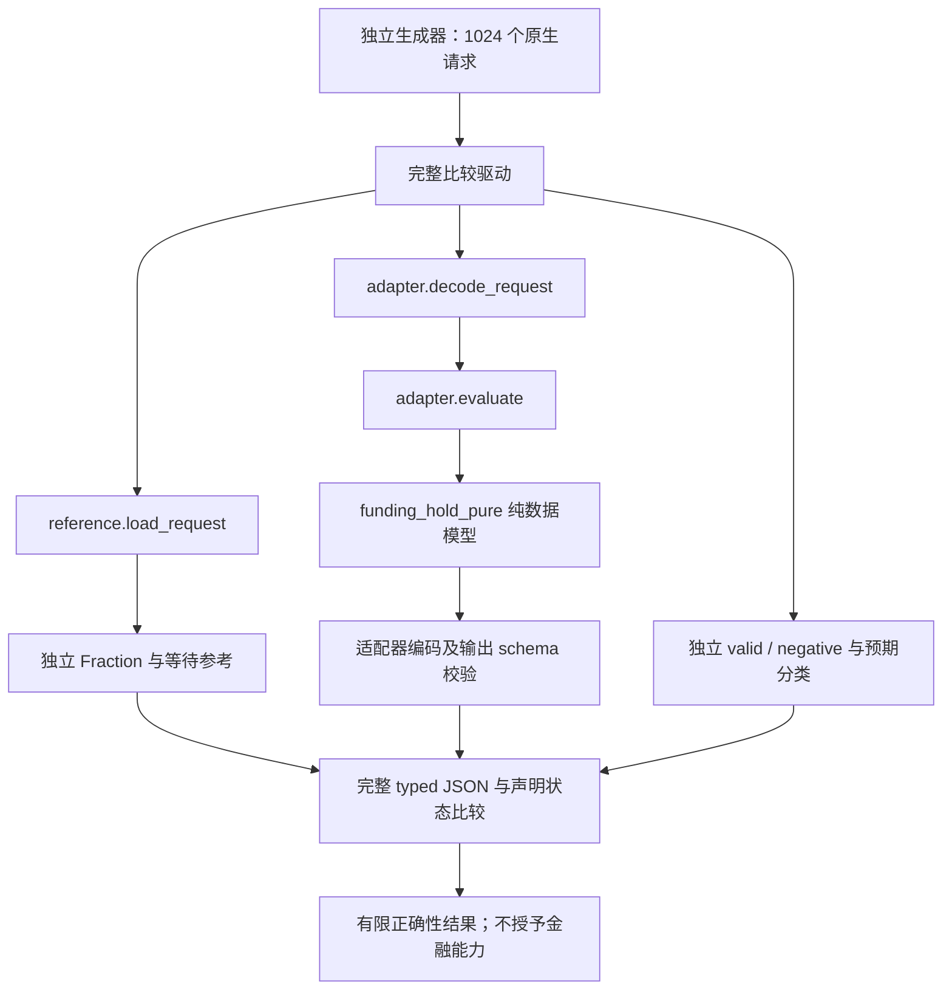
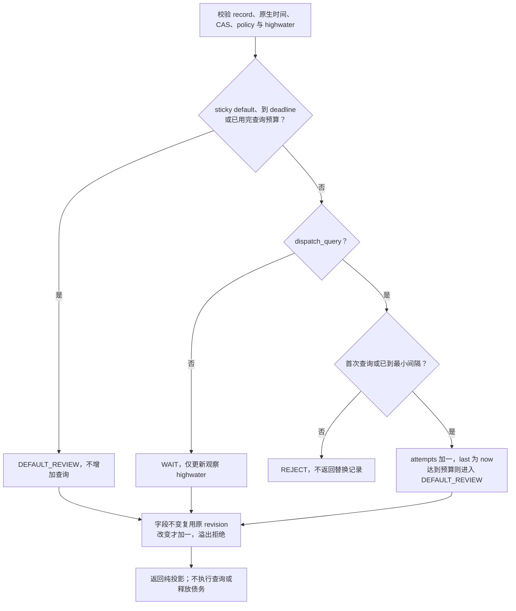

# 独立资金费预占参考：等待与拒绝分类

本页对应 PR #65 的后续测试修复候选。`funding_hold_pure` 是只处理调用方给定 USD 数据的独立 D1 模型；它没有接入下单、还款、撤单、资金划转或持久权威。所有激活标记仍为 `false`，D2 保持 BLOCKED。这里修正参考模型及样例的契约，不修改目标运行时、风险参数或既有保护测试。

## 两条独立验证路径



源码：[生成器](../tests/funding_hold_d1_reference_cases_v3.py)、[独立参考](../tests/reference_funding_hold_d1_v3.py)、[目标适配器](../tests/funding_hold_target_adapter_v3.py)、[纯模型](../uta/funding_hold_pure.py)、[完整比较驱动](../tests/test_funding_hold_full_field_v3.py)。适配器仅编解码、调用和校验返回值，不计算期望金额；参考模型不导入生产模型。比较保留字段、原生类型和数组顺序，不能用两个相同拒绝通过声明有效的案例。

这张图没有金融提交边界：这些调用不读时钟、不写 SQLite、不建立 outbox，也不派发查询。真正的持久 CAS、全局 action 所有权、查询先计数再投递、外部 ACK 和经济状态核对仍是 D2 的独立门槛。

## 观察与查询申请不同

`preview_wait(..., dispatch_query=False)` 表示仅观察等待状态；`True` 是执行前的明确查询计数申请。在未进入 DEFAULT_REVIEW 时，已有查询且尚未达到最小间隔的明确申请必须拒绝，目标错误为 `query_too_early`。这项要求已存在于 [目标保护测试](../tests/test_funding_hold_pure.py) 的 `test_wait_interval_and_deadline_equality_do_not_grant_late_query`；本次没有放宽该守卫。



顺序依据：[preview_wait](../uta/funding_hold_pure.py) 与 [参考 _wait_preview](../tests/reference_funding_hold_d1_v3.py)。DEFAULT_REVIEW、deadline 和预算检查先于间隔检查；已经失去查询资格时不再投影新查询。时钟回退、错误 CAS 或策略摘要仍先拒绝。未知查询结果不退还计数，也不能靠重启延长首次 deadline。

下表每行都从同一记录独立试算：`started=last=highwater=0`、`attempts=revision=1`，最小间隔 5,000,000 微秒、deadline 为 30,000,000 微秒、查询预算 4。这是合成测试政策，不是生产默认值。

| now_us | dispatch_query | 结果 | 返回的 attempts / revision |
| ---: | --- | --- | --- |
| 4,999,999 | true | REJECT，不返回新记录 | 原记录仍为 1 / 1 |
| 4,999,999 | false | OK / WAIT，仅推进 highwater | 1 / 2 |
| 5,000,000 | true | OK / WAIT，计数一次 | 2 / 2 |
| 5,000,001 | true | OK / WAIT，计数一次 | 2 / 2 |
| 30,000,000 | true | OK / DEFAULT_REVIEW，不计新查询 | 1 / 2 |

同一时刻的只读观察可以复用记录；同一时刻再申请一次过早查询不能被改称成功的幂等回执。D1 不提供真实查询命令的持久幂等性。

## 不支持的范围与无效输入分别报告

V3 信封用 `UNSUPPORTED_OPERATION_OR_CAPABILITY` 表示 UNSUPPORTED，用 `REJECTED_INPUT_OR_PRECONDITION` 表示 REJECT；两者的 `value` 都必须为 null，且均不授予能力。不能把“不支持”当成零负债、有效付款或成功的新状态。

| 前提与场景 | 当前公开结果 | 目标源码边界 |
| --- | --- | --- |
| CAS 与 lineage 正确，但 FINAL 超过已给定 U cap | UNSUPPORTED，保留原状态 | `DutyState.__post_init__` |
| 完整 CAS 正确，但再次改变 FINAL | UNSUPPORTED | `advance_stage` |
| 提供集合明确不完整、含未评估 duty，或要求跨 scope / scale 聚合 | UNSUPPORTED | `aggregate`、`_key_scope`、`_same_scale` |
| base 没有明确排除资金费组成 | UNSUPPORTED；非字符串标记仍 REJECT | `BaseValues.__post_init__` |
| 存在 own duty，但不是固定应付 | UNSUPPORTED；缺失 own duty 仍 REJECT | `backing_precondition` |
| 过早查询、错误 CAS、改变 lineage、非法类型或越界 scale | REJECT | 对应的输入与前提守卫 |

以上类型边界见 [纯模型](../uta/funding_hold_pure.py)。参考侧保留独立算术与校验实现，修正这些响应类别；没有改写金额公式、cap、期限、计数上限或保护条件。

## 原失败与新样例的身份

原源码 `7a4f41a6` 的首轮 [push](https://github.com/PureGamma-Harness/uta-unified-account/actions/runs/44374507297) 和 [PR](https://github.com/PureGamma-Harness/uta-unified-account/actions/runs/44374579916) 均失败，详见 [原首轮记录](funding-hold-v3-first-ci.md) 与 [独立评审](https://github.com/PureGamma-Harness/uta-unified-account/pull/65#issuecomment-6991578259)。本地未修改源码的 5 项完整比较测试复现了 seed 321：声明 OK、参考 OK、目标 REJECT，未完成 1024 项流。

原 seed 321 的 start / last 为 100,000,000，now 为 104,999,999，`dispatch_query=true`。其排序、紧凑、ASCII JSON 请求为 842 字节，SHA-256 为 `90e77f4246fd8c533cd1ca577f5e8b40dec95890482d0a1fb062ed35fe1e602f`；[新契约回归](../tests/test_funding_hold_contract_boundaries_v3.py) 原样重建并保留该拒绝输入。

修复后的生成器仍有相同的 1024 个有序 seed / case ID、十种 operation、512 valid 与 512 negative。13 个 valid 等待输入只把过早的查询申请改为只读观察；50 个 negative 的请求载荷完全不变，仅将错误声明的 REJECT 改为目标已经公开的 UNSUPPORTED。其他输入不变，原源码、历史生成器身份和红色 CI 不被覆盖。新流必须使用自己的请求/响应 hash，不能继承旧流结论。

## 验证命令与范围

```sh
python -m unittest discover -s tests -p 'test_funding_hold*.py' -v
python -m unittest discover -s tests -v
```

本轮 Python 3.12 本地专项共 112 项通过，包含新增八项完整响应、输入不变性及边界回归。完整驱动的 1024 项实际输出为 OK 512、REJECT 414、UNSUPPORTED 98，两侧完整响应流 hash 相同；原完整比较驱动的五项测试和目标模型保护测试保留原字节。`CODE_CONTRACT_IMPLEMENTED_NOT_RUN` 仍是既有 wire 的固定标记，不是当次执行状态；是否执行和通过须看绑定源码的测试结果。

完整回归与跨版本 CI 以 PR 的具体提交和运行记录为准。字节一致的 wheel / sdist 与通用安装检查不能替代新组件在安装包中的直接功能验证；有界 Python 枚举也不是 TLC 证明。金融集成、真实查询/取消、长期稳定性、HA、持续容量及真实资金批准仍未完成。
