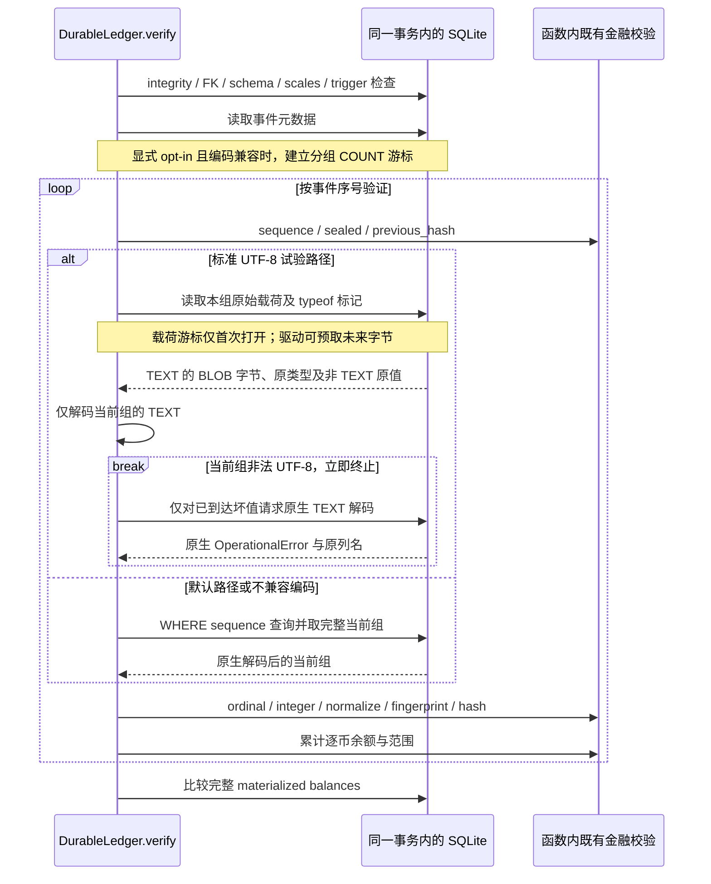

# 可选账本回放：预取、解码与首错顺序

`DurableLedger.verify(ordered_postings=True)` 是独立分支上的显式试验，默认仍为 `False`。本次修复解决读取顺序的兼容性，不启用启动优化、缓存或新的金融操作。当前默认分支不含此实现；原性能观测和失败记录见 [发布记录](history-postings-stream-publication.md)。

## 已复现的问题

原 `e3df52f` 的载荷游标按 `COUNT(*)` 消费当前事件，仍不能保证驱动不提前解码下一行。在 Python 3.10.22 / SQLite 3.53.1 的合成探针中，当前事件有两行合法 TEXT、下一事件首行含非法 UTF-8；第二次取行尚未返回当前事件尾行，驱动已抛出下一事件的 `OperationalError`。同一 SQLite 版本上的 Python 3.12.14 在第三次取行才报告该错误。

因此，当较早事件的指纹已损坏，或下一事件的哈希链本应先失败时，试验路径可能先报告未来载荷的解码异常。原有 27 项专项测试在本轮 Python 3.10 环境复现三个失败，包含 account/units 两个子案例；这是首错契约回归，不是资金丢失证据。原 [push CI](https://github.com/PureGamma-Harness/uta-unified-account/actions/runs/44129043659) 的 Python 3.10 失败及独立评审记录继续保留。

## 当前读取边界

当前实现仅在标准 `str` text factory、UTF-8 数据库且显式 opt-in 时使用两游标路径。通过一个常量 BLOB 编码探针选择兼容路径；其他编码或调用方 text factory 沿用原逐事件查询，不改变连接的 factory。



源码：[DurableLedger.verify / Database._using](../uta/storage.py)。两条路径沿用同一事务快照及既有 writer/identity guard；本函数不写表，也不保存可跨调用复用的验证结果。首次载荷查询仍在当前事件链检查之后；缺失组不会取后续载荷来补齐。

字节投影同时保留 `typeof`：原来存成 BLOB 的 account/units 仍为 BLOB，不能被转成合法字符串。当前组必须完整解码后才执行 ordinal 和整数语义校验，保持原 `fetchall` 的组内错误顺序。若当前 TEXT 本身非法，则交由同一连接的原生 TEXT 解码报告原异常；不忽略坏值、不替换字符、不修改异常文案或连接 factory。

## 验证与限制

在各受支持 Python 环境运行：

```sh
python -m unittest discover -s tests -p test_history_postings_stream.py -v
python -m unittest discover -s tests -v
```

[专项测试](../tests/test_history_postings_stream.py) 保留原有首错等价、完整计数、哈希/余额、完整性、FK、触发器及默认关闭断言，当前覆盖以下兼容边界：

| 场景 | 必须保持的行为 |
| --- | --- |
| 未来事件坏 TEXT 与更早指纹/链错误并存 | 先报告与默认路径相同的较早金融错误 |
| 当前组同时有坏 TEXT 与整数/ordinal 错误 | 当前组原生解码错误仍先发生 |
| BLOB 内容看起来是合法 UTF-8 | 保留原储存类型及原拒绝结果 |
| UTF-16 authority 含中文科目 | 使用原逐事件完整回放 |
| 借用连接的自定义 text factory | 保留成功/首错结果及 factory 对象身份 |

标准 UTF-8 非空历史仍有一次分组查询和一次载荷查询，另有常量编码探针；这不是总 SQL 数恒等于二。事件元数据与完整余额映射仍占用内存，载荷按组解释也不代表物理 I/O 不会预读。新投影和解码增加实际工作，旧 ABBA、profile 和 53 输入一致性证据只属于其原冻结源码，不能传递为本次修复的性能结论。

本轮不重新执行 ABBA 或长稳任务，不接触既有活动 authority，不改变 schema、风险参数及默认启用状态。原共享门闩故障/回收类 CI 失败与此首错问题分别记录；本修复不证明其原因或关闭其验收项。后续性能与独立审阅仍须使用新的明确源码及完整证据。
