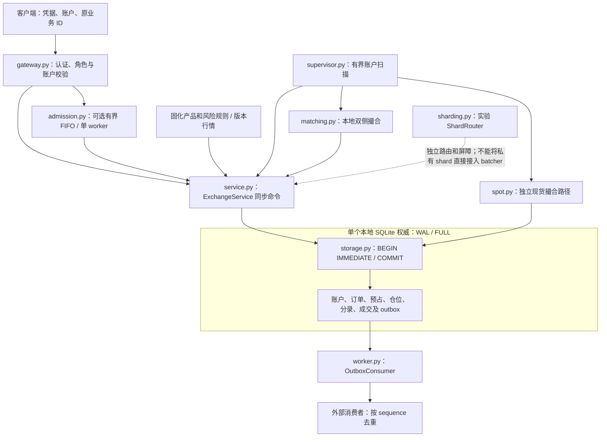
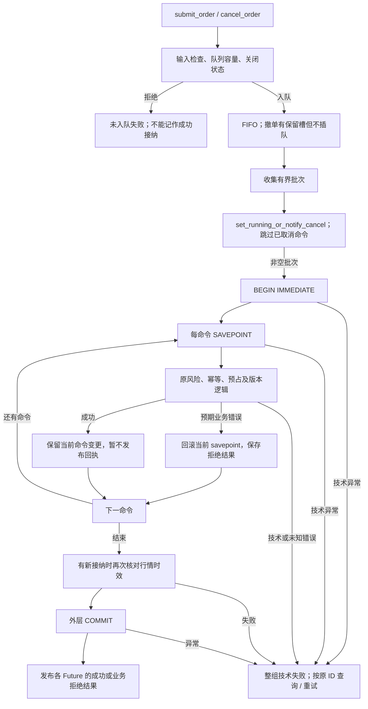
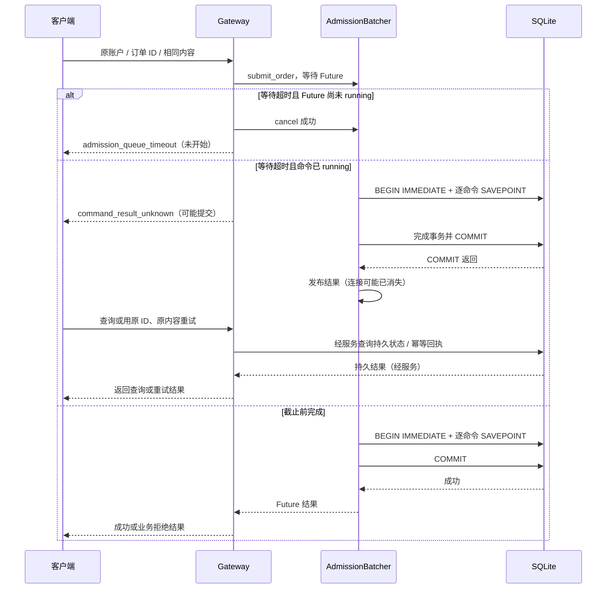

# 已实现交易路径：架构、流程与时序

本页核对基线为 PR #3 `92086bd8fbd1d41427a614dfdd60dce183396258`，描述该候选分支，不代表已合并 main、已部署或获准实盘。旧研究模拟器见 [architecture.md](architecture.md)，未来目标见 [target-architecture.md](target-architecture.md)。三者不可混用。以下均为本地合成资金工程验证，不包含真实交易所或托管接入。

## 1. 实现架构与原子边界

源码入口：[网关](../uta/gateway.py)、[服务](../uta/service.py)、[存储](../uta/storage.py)、[批提交](../uta/admission.py)、[监督器](../uta/supervisor.py)、[撮合](../uta/matching.py)、[现货](../uta/spot.py)、[outbox](../uta/worker.py)。图中共享一个本地权威不代表跨库原子性、跨区域复制或 HA。Outbox 的租约约束 checkpoint，不能 fence 外部回调；外部投递是至少一次。

## 2. 分组准入流程

依据 `AdmissionBatcher._commit_batch`。业务错误有明确 allowlist；未知错误不是可忽略客户拒绝。提交前的行情检查不是对 COMMIT 后延迟的绝对保证。批次不是客户端原子多腿请求：一个命令业务拒绝不撤销同批其他有效命令。`committed_commands` 包含重试，不能替代唯一订单吞吐。

## 3. 回执与超时恢复时序

该图表示互斥情形而非每个请求都会提交。取消成功的命令不执行；批次仍可包含其他命令。技术异常的 `admission_batch_failed` 也不无条件意味着未提交。依据 `gateway._Handler._order_command` 与 `admission.py`；恢复时不能换新 ID 盲目重发。

## 4. 撮合、清算与失败边界

`ExchangeWorker.run_once` 先有界扫描账户并调用 `supervise_account`，再按产品调用 matcher。清算计划不是成交；无对手流动性时不能假造平仓。`Matcher.match_once` 在本地事务内读取订单、按价格/序号排序，执行双侧 `_apply_fill`，写唯一成交和审计事件，再提交。单侧拒绝回滚配对 savepoint；意外存储错误中止事务。它没有先发外部订单再回填本地状态的协议。现货走独立 `SpotExchange` 路径，不能把线性合约图当成全部产品实现。

分片撮合只在单片内执行，跨片转账未实现；借贷清算有明确阻断，不能把线性清算路径推广到所有负债。Cutover 回执的 `source_fence_verified` 为 false，不证明真实来源已停止写入。行情时间新鲜也不等于来源、价格或金融参数已独立认证。

## 5. 如何证伪这些图，以及仍然缺少什么

| 主张 | 对应证据入口 | 不覆盖的结论 |
| --- | --- | --- |
| 回执在 COMMIT 后 | `tests/test_admission.py`、`tests/test_admission_faults.py` | 网络收到成功前后不会发生任何故障 |
| 双侧本地结算 | `tests/test_matching.py`、`formal/explore_settlement.py` | 跨分片 / 外部交易所结算安全 |
| 结果未知可恢复 | 批提交与网关测试、独立进程故障测试 | 客户端换新 ID 后仍可去重 |
| 有界协议安全 | `formal/explore_group_commit.py` | 无限状态数学证明、生产金融签字 |

复跑命令和签核条件见 [acceptance-gates.md](acceptance-gates.md)。生产仍需闭合持续容量、混合负载、真实产品校准、复制与旧主 fencing、灾备 RPO/RTO、安全审计及真实责任人批准。不得把本页图示、模拟验收或 CI 绿灯当作实盘许可。
