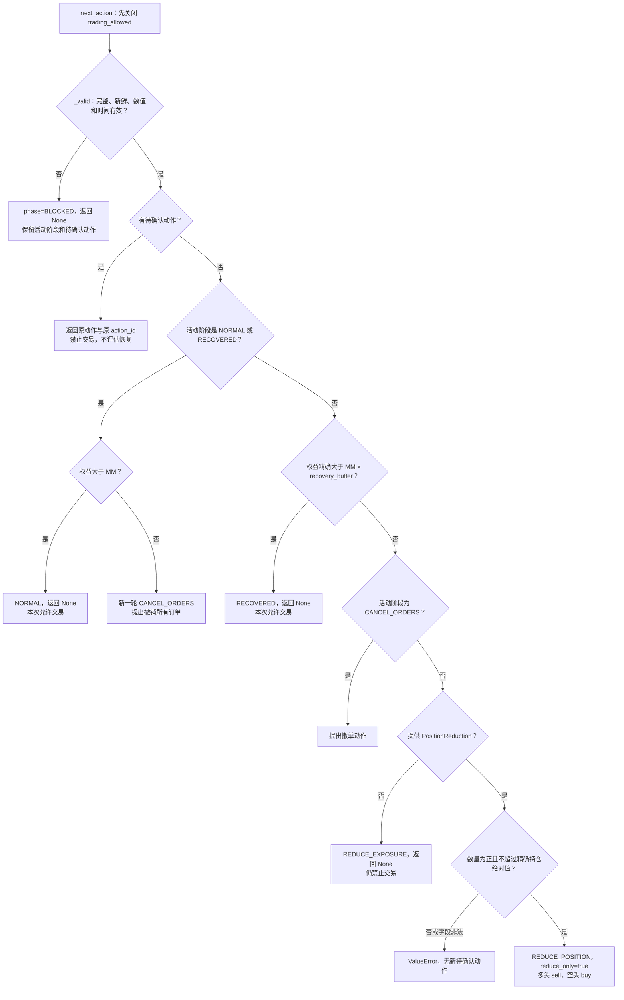
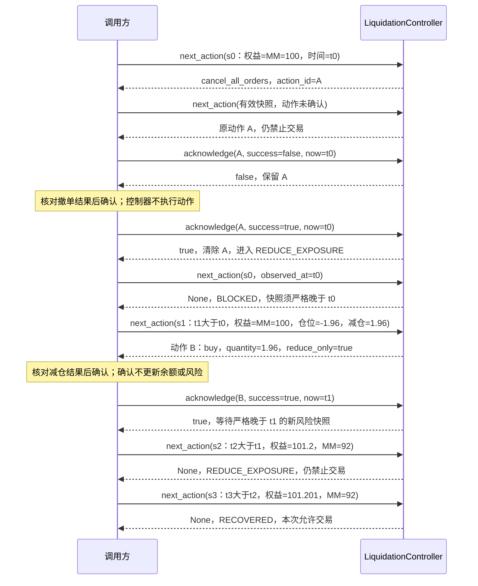

# 独立内存清算控制器

[uta/liquidation.py](../uta/liquidation.py) 的 `LiquidationController` 为一个账户提出撤单或只减仓动作，由调用方执行并确认。`python -m uta demo` 只演示撤单建议。它保存进程内阶段、待确认动作和已确认 ID，没有数据库事务、撮合或外部交易所调用。`lab` 的持久化清算使用另一套 [Simulator 流程](workflows.md)。

## 决策顺序与状态

`TimedRisk` 包含 `risk.equity`、`risk.maintenance_margin`、带时区的 `observed_at` 和完整性标志。权益、MM 必须是有限 `Decimal`，MM 非负。默认最大年龄为 10 秒，恰好 10 秒有效；未来、缺失时区、不完整、早于已见快照，或不严格晚于上次成功确认时间的数据均被阻断。



依据：[LiquidationController._valid / next_action](../uta/liquidation.py)。图中的活动阶段是内部 `_active_phase`：阻断不会清除它；下一次有效快照会恢复该阶段，再检查待确认动作。返回 `None` 可以表示阻断、等待减仓输入或健康，须结合 `phase` 与 `trading_allowed` 判断。

成功确认撤单后进入 `REDUCE_EXPOSURE`；减仓确认后保持该阶段。恢复条件只用于仍在清算周期、没有待确认动作的评估。进入 `RECOVERED` 后，下一次有效评估重新按 `权益 > MM` 决定回到 `NORMAL` 或开始新一轮清算。`trading_allowed` 只描述最近一次评估，时间流逝不会自动更新它，调用方应在每次订单前重新评估。

## 动作确认与新快照



依据：[next_action / acknowledge](../uta/liquidation.py)、[test_cancel_then_reduce_and_recover_with_new_snapshots](../tests/test_liquidation.py)。图中各快照均完整、未过期，`now` 等于观察时间，缓冲使用默认 1.10。

`acknowledge` 的 `False` 可表示失败确认或重复确认。失败保留同一动作；成功 ID 的再次确认是内存中的无操作。未知或乱序 ID、无时区的确认时间、早于已见快照的确认时间抛出 `ValueError`。调用方必须串行访问控制器，并核对结果不明的动作；进程重启会丢失阶段和 ID，该模块没有跨进程幂等保证。

## 精确阈值和减仓上限

清算恢复使用严格大于，默认缓冲及触发条件未改变。在已确认撤单、无待确认动作、使用新鲜快照时：

| 输入 | 预期行为 |
| --- | --- |
| MM=92，权益=101.19 | 小于阈值 101.2，保持 `REDUCE_EXPOSURE` |
| MM=92，权益=101.2 | 等于阈值，仍不恢复 |
| MM=92，权益=101.201 | 越过阈值，进入 `RECOVERED` |
| 仓位=-1.96，减仓=1.97，权益尚未恢复 | 超过精确绝对值 1.96，拒绝 |
| 仓位=-1.96，减仓=1.96，权益尚未恢复 | 提出买入只减仓建议 |

调用方设置 `Decimal` 精度为 2 时，直接计算 `92 × 1.10` 会舍入成 100，`abs(Decimal('-1.96'))` 会舍入成 2.0，分别导致提前恢复和放行超量减仓。[_above_recovery_threshold](../uta/liquidation.py) 先比较调整后指数，再将正数尾数缩放到有限区间，用足以容纳乘积的独立上下文精确比较；持仓上限使用不舍入的 `copy_abs()`。比较不改变调用方精度、舍入方式、指数范围、陷阱或已有标志。

控制器自身不沿用风险模型的 ±100 指数限制；来自 `calculate_risk` 的数据仍受 [风险模型输入边界](risk-model.md) 约束。极小指数回归使用紧凑 Decimal 表示，只验证阈值比较，不扩大产品范围或证明上游风险计算正确。1.10 是项目已有的演示参数，不是交易所规则。

定向验证：

```bash
python -m unittest discover -s tests -p test_liquidation.py -v
```

测试及完整贡献检查见 [验证与证据](verification.md)。这些证据覆盖内存决策与比较边界，不包括真实撤单、成交、外部幂等、重启恢复或持久化模拟器的端到端验收。
