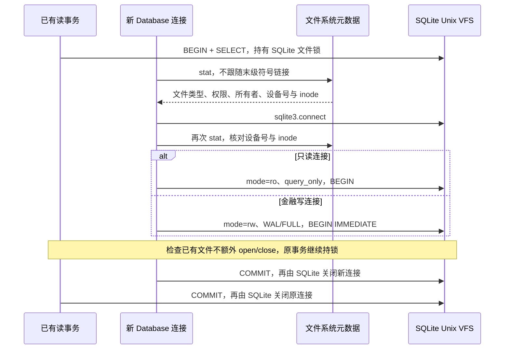

# SQLite 文件检查与进程锁

本文对应认证交易链路的 [Database](../uta/storage.py)、[分片数据库](../uta/sharding.py) 和 [认证 nonce 数据库](../uta/request_signing.py)。研究模拟器的 [Store](../uta/store.py) 使用另一套连接入口。

## 已确认的问题与修复边界

同一进程已有 SQLite 连接持锁时，对同一个数据库文件额外执行一次普通 `os.open()` / `os.close()`，会清除该进程在这个文件上的 POSIX record locks。SQLite 不知道这些锁已消失，后续多进程访问可能失去互斥。原来的三个 `_private_file` 实现为检查文件身份而执行了这组操作，每次新建读连接也会触发。

依据为 [SQLite 官方说明 §2.2](https://sqlite.org/howtocorrupt.html#_posix_advisory_locks_canceled_by_a_separate_thread_doing_close_) 和实际跨进程锁探测。官方说明还指出，SQLite 3.51.0 起增加了部分 WAL 防护，但不能代替调用方修复。因此，新版本 SQLite 上一次测试通过，不能排除旧版本中的锁破坏。

当前入口对**已存在的数据库**仅执行 `os.stat(..., follow_symlinks=False)`，核对普通文件、所有者及私有权限；SQLite 打开后再次比较设备号与 inode。分片和认证库缺失时继续拒绝，不自动重建。

首次创建先在同目录建立 0600 临时 inode、同步并关闭其描述符，再以排他 hard link 原子发布目标路径；已存在目标不被覆盖。认证库只允许显式 `NonceStore.initialize` 创建。目标可见前创建描述符已关闭，同进程其他 SQLite 连接不会观察到一个仍可能被应用 raw close 的已发布 inode。该文件发布方式不代替 SQLite 事务锁、writer token 或跨进程 fencing。只读连接使用 `mode=ro`，不隐式建库或切换 journal；金融写连接继续使用 WAL/FULL。数据库目录与服务 OS 用户仍属于可信边界。

该变更不做数据迁移或历史修复。已经出现回执缺失或保护清单不一致的 authority 应保留停机，保存完整数据库及 WAL，并核对 inbox、订单、账本与审计事实；升级代码本身不能证明原有 ACK 对应的历史仍完整。

## 已存在数据库的新连接时序



源码顺序见 [Database._private_file / _connect / _role_transaction](../uta/storage.py)，两个已有库检查分别见 [_BoundShardDatabase._private_file](../uta/sharding.py) 与 [_ExistingAuthDatabase._private_file](../uta/request_signing.py)。图中没有改变金融事务、终态回执或租约的提交边界。

## 可重复的回归验证

```bash
python -m unittest discover -s tests -p test_storage_locks.py -v
python -m unittest discover -s tests -p 'test_storage*.py' -v
```

[test_storage_locks.py](../tests/test_storage_locks.py) 为三个数据库入口分别建立真实 WAL 读事务，使用独立解释器在 SQLite Unix VFS 的 SHARED 锁范围尝试非阻塞排他 record lock：

| 时点 | 必须观察到的结果 |
| --- | --- |
| 没有活动读事务 | 子进程可以取得探测锁，确认探针有效 |
| 原读事务已读取数据 | 子进程被阻止 |
| 第二个连接已打开并读取 | 子进程仍被阻止 |
| 第二个连接已关闭，原事务仍在 | 子进程仍被阻止 |
| 原事务与连接已关闭 | 子进程可以再次取得探测锁 |

原实现会在“第二个连接已打开”阶段失败。测试不使用随机等待、不放宽回执检查，也不关闭持久 guard。文件权限、符号链接和每次连接重新检查权限的用例见 [test_storage_permissions.py](../tests/test_storage_permissions.py)。探测针对 POSIX 与 SQLite Unix VFS，不证明任意文件系统或其他 VFS 的锁语义；持续负载、断电、磁盘丢失和跨主机恢复仍需分别验收。
