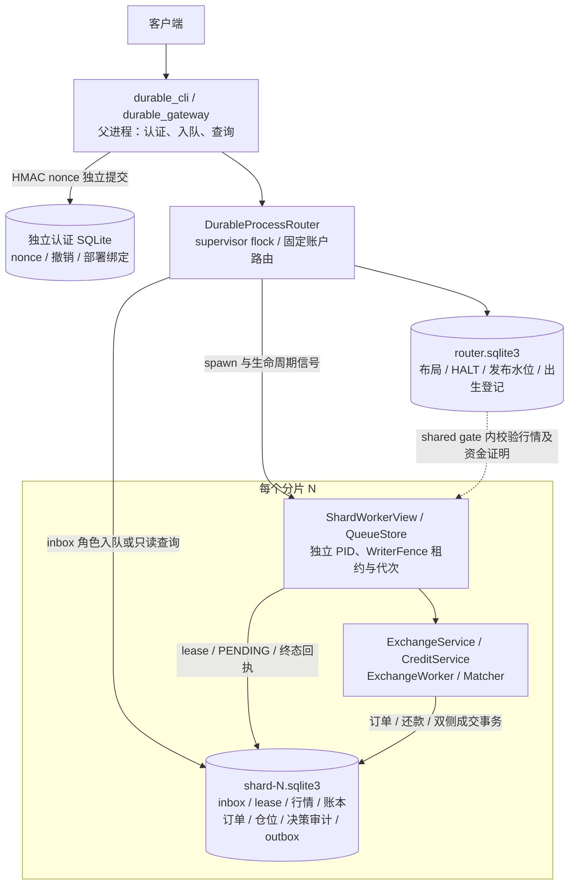

# UTA / PM 目标架构与交付边界

集成负责人：根工程 agent。金融规则、接口和独立验证分别审查，生产资金启用仍需真实授权负责人批准。当前是单主机合成验收候选；本页先列出当前分支已接线的 managed 路径，再说明后续目标。独立评审分支的实现不代表默认分支或生产环境已启用，交付状态见 [当前里程碑](milestone-durable.md)。

## 当前 managed 模块与文件边界

下图对应 `uta-durable serve` 的已有 managed 布局。N 为四位分片编号（如 `0000`），账户映射固定，每片都有自己的文件和 writer PID；图中边表示调用或校验依赖。

源码：[CLI 生命周期](../uta/durable_cli.py)、[HTTP producer](../uta/durable_gateway.py)、[进程监管与恢复](../uta/durable_process.py)、[账户路由及 ShardWorkerView](../uta/sharding.py)、[inbox 协议](../uta/durable_commands.py)、[存储角色](../uta/storage.py)、[租约与 SQL guard](../uta/writer_fence.py)、[后台清算与撮合](../uta/supervisor.py)。认证库与各金融分片分别提交；生命周期管道不携带业务命令或财务事实。

## 当前原子边界

| 执行路径 | COMMIT 所覆盖的事实 | 边界 |
| --- | --- | --- |
| v1 同步 / 非 managed `ShardRouter` | 单个文件内的账户、订单预占、仓位、现金分录、业务幂等和 outbox | 同步入口在金融 COMMIT 后返回；分片 router 的一次账户命令落在一个固定分片 |
| managed v2 入队 | 目标分片的 `uta_command_inbox` PENDING 或已有回执 | `202 durably_queued` 等待 inbox COMMIT；此时没有接纳、预占或成交保证 |
| managed writer 执行（required profile） | 该命令的金融变更、决策审计及 SUCCEEDED 回执；业务拒绝先回滚 savepoint 再记 REJECTED | 同一分片、同一连接和金融事务；技术异常不能伪造业务终态 |
| 后台撮合 | 同分片对手两侧的成交、仓位/现金、唯一成交回执及事件 | 是接纳之后的独立金融事务，不改写原下单终态；没有跨分片结算 |

各金融写事务使用 `BEGIN IMMEDIATE` 在读风险前取得写锁，WAL/FULL 的 COMMIT 返回后才确认对应阶段。managed writer 还须在事务及提交边界通过 PID/代次/有效期检查；`ShardWorkerView` 把 router shared gate 持有到金融 COMMIT 完成，避免全局发布/停机与该次金融修改交错。详细时序见 [进程事务边界](durable-process.md#入队接纳与成交的事务边界) 和 [v2 回执契约](durable-api.md)。

本地撮合在同一个金融事务验证并结算买卖两侧。可识别的执行拒绝回滚该候选的双侧 savepoint，再按策略保留或撤销对应订单；未预期技术异常回滚整个撮合批次。成功候选的两侧与唯一回执一起提交，详见 [Matcher](../uta/matching.py)。跨分片版本仍须增加耐久成交义务、两侧 prepare/commit 状态、可见性隔离和恢复对账；完成故障注入前禁止把两个独立数据库拼接为生产撮合。

`apply_fill` 是本地执行授权命令，不是不可撤销的外部成交事实摄入。执行前使用最新有效行情与剩余订单占用重新检查；成功重试先查历史幂等记录。真实外部执行器需要独立的提交/确认/结果未知/撤单中协议；不能先对外成交再调用这个可拒绝的本地入口。

## 权威数据与版本

| 数据 | 当前实现 | 决策要求与目标 |
| --- | --- | --- |
| 资产 | 逐币 integer minor-unit 账本 | 原始总额、可用、冻结、待结算和托管交接可分辨 |
| 本金/利息 | 独立负债科目及投影 | 不与同币资产净额化，信用额度及资金池事务核对 |
| 仓位 | signed quantity + 精确 cost basis | 产品、乘数、结算币由目录限定；展示均价不作为重放输入 |
| 行情 | 不可变版本快照 | 每个决策携带 market version/time；目标补 index/mark/executable/vol surface |
| 规则 | 固化配置和版本产品/风险定义 | 同一决策使用同一规则版本；目标补双人审批、影响试算、灰度和回滚 |
| 命令 | 同库持久 inbox、内容冲突检测和独立金融终态 | 响应丢失按原账户/ID 查询；技术超时不等于业务拒绝 |
| 决策审计 | required profile 保存历史行情、政策及接纳/执行决策 | 新确认事实同事务关联；既有 legacy gap 保留，不补造旧决策 |
| 事件 | append-only outbox + cursor | 至少一次投递，消费者按 sequence 去重；不能宣称外部 exactly-once |

## 产品与账户模式

交付顺序为 M0 持久基础、M1 合成纵向链路、P1 首批生产验收、P2 多结算/交割/反向、P3 期权和 PM。M1 的单一合成 USD 结算只用于工程验证。P1 目标应选择经批准的首个稳定币结算产品，证明其脱锚、PnL、费用和抵押规则；不能直接重命名 USD 通过验收。

认证金融主链路当前只能启用 Cross 已实现路径。Isolated、PM、条件单、自动借币、市价、改单、多腿以及提现/跨账户划转均需要单独规格和验收；未实现 API 返回明确错误或不存在，不降级为另一种操作。研究 `Simulator` 的场景 PM 是独立参考权威，见 [研究说明](research-lab.md)。产品目录能描述一个期权不代表可以交易期权。完整支持矩阵见 [产品边界](product-support.md)。

Isolated 目标以仓位隔离资金与对应负债为边界；Cross 在账户内按允许规则合并；PM 按合资格风险单元做场景重估和附加计提。模式转换本身是增量风险命令：冻结新增请求、处理在途订单/借款、同一市场快照重算目标模式、持久切换版本；未完成不能通过改一个字符串实现。

## 已实现分片与后续目标

当前 `ShardRouter` 按固定的 `sha256-utf8-big-endian-mod-v1` 将完整账户映射到 1..256 个本机分片，布局封存后不能在线重分片。managed 模式每片有独立 writer 进程及持久租约，同账户 PENDING 按 FIFO 执行；不同分片可以独立推进，但同一交易对在不同分片的订单不能互相撮合。缺分片、身份或资金证明不一致保持全局 stop，不自动重建权威文件。

行情发布使用全局 HALTED/PUBLISHING、确定的每片命令 ID 和完整回执/水位核对；收齐仍 HALTED，须显式激活。控制库和各片之间没有单个跨库 COMMIT，部分发布靠关闭 gate、原 ID 重试和核对恢复，见 [发布协议](durable-process.md#行情停机和全局部分发布)。队列限制 PENDING，撤单/还款有保留容量但不能越过本账户队头；历史回执和数据库字节并不因此有界。按 API key/热账户速率配额仍须独立实现及验收。

| 后续目标 | 当前可用的相关能力 | 未完成的边界 |
| --- | --- | --- |
| 经典账户连续切换 | 经典快照摘要、原子导入及回执 | 真实源 fencing、连续增量和权威移交 |
| 外部投递与接入 | 本地 append-only outbox、可恢复消费者游标及 HTTP | 私有 WebSocket、外部消费者幂等与互联网边缘接入验收 |
| 托管和跨分片结算 | 合成资金证明、本地双侧原子撮合 | 链上/托管确认协议、跨分片成交义务及恢复对账 |
| 多节点容灾 | 本机 PID fencing、持久 SQL guard 和进程恢复 | 多故障域复制、受信恢复及 AZ 失效验收 |

持久日志复制到多个故障域并记录已确认水位后才能承诺 AZ 故障 RPO。目标为已确认命令在所定义故障模型中 RPO=0；当前只有本地 FULL 落盘和进程崩溃测试，不具备 AZ 级保证。旧主恢复必须携带过期 fencing token 被存储拒绝，不能仅依赖负载均衡切流。

容量验证分为纯计算、局部持久组件、单机完整撮合和多节点完整链路。开放环记录计划到达至完成的延迟、唯一接纳/成交、业务拒绝、技术失败、未知结果和积压。正式门槛见 [验收与审批](acceptance-gates.md)，任何较小测试通过都不自动提升为 P1 通过。
