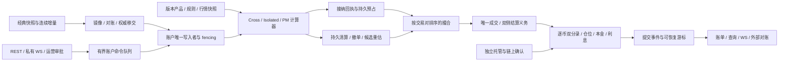

# UTA / PM 目标架构与交付边界

集成负责人：根工程 agent。金融规则、接口和独立验证分别审查，生产资金启用仍需真实授权负责人批准。当前实现是单节点合成验收环境；下图同时标明目标分片边界，不能解读为已部署的多节点系统。

## 当前原子边界

一个受控本地 SQLite 文件是单一权威。`BEGIN IMMEDIATE` 在读风险前取得写锁，WAL/FULL 的 COMMIT 完成后才返回成功。账户、预占、订单、仓位、现金分录、幂等记录和 outbox 共用事务。独立连接和进程可以竞争该锁，但这不是账户级分片、租约选主或复制协议。

本地撮合使用同一个事务验证并结算买卖两侧，随后保存唯一成交回执；任一侧或回执写入失败全部回滚。它不声称解决跨分片原子提交。跨分片版本必须增加耐久成交义务、两侧 prepare/commit 状态、可见性隔离和恢复对账；完成故障注入前禁止把两个独立数据库拼接为生产撮合。

`apply_fill` 是本地执行授权命令，不是不可撤销的外部成交事实摄入。执行前使用最新有效行情与剩余订单占用重新检查；成功重试先查历史幂等记录。真实外部执行器需要独立的提交/确认/结果未知/撤单中协议；不能先对外成交再调用这个可拒绝的本地入口。

## 权威数据与版本

| 数据 | 当前实现 | 决策要求与目标 |
| --- | --- | --- |
| 资产 | 逐币 integer minor-unit 账本 | 原始总额、可用、冻结、待结算和托管交接可分辨 |
| 本金/利息 | 独立负债科目及投影 | 不与同币资产净额化，信用额度及资金池事务核对 |
| 仓位 | signed quantity + 精确 cost basis | 产品、乘数、结算币由目录限定；展示均价不作为重放输入 |
| 行情 | 不可变版本快照 | 每个决策携带 market version/time；目标补 index/mark/executable/vol surface |
| 规则 | 固化配置和版本产品/风险定义 | 同一决策使用同一规则版本；目标补双人审批、影响试算、灰度和回滚 |
| 命令 | 持久业务 ID 与内容冲突检测 | 响应丢失重查原 ID；技术超时不等于业务拒绝 |
| 事件 | append-only outbox + cursor | 至少一次投递，消费者按 sequence 去重；不能宣称外部 exactly-once |

## 产品与账户模式

交付顺序为 M0 持久基础、M1 合成纵向链路、P1 首批生产验收、P2 多结算/交割/反向、P3 期权和 PM。M1 的单一合成 USD 结算只用于工程验证。P1 目标应选择经批准的首个稳定币结算产品，证明其脱锚、PnL、费用和抵押规则；不能直接重命名 USD 通过验收。

当前只能启用 Cross 已实现路径。Isolated、PM、条件单、自动借币、市价、改单、多腿以及提现/跨账户划转均需要单独规格和验收；未实现 API 返回明确错误或不存在，不降级为另一种操作。产品目录能描述一个期权不代表可以交易期权。完整支持矩阵见 [产品边界](product-support.md)。

Isolated 目标以仓位隔离资金与对应负债为边界；Cross 在账户内按允许规则合并；PM 按合资格风险单元做场景重估和附加计提。模式转换本身是增量风险命令：冻结新增请求、处理在途订单/借款、同一市场快照重算目标模式、持久切换版本；未完成不能通过改一个字符串实现。

## 分片、容量与容灾目标

以账户或完整风险组映射到唯一分片，账户命令串行；撮合按交易对串行。清算/撤单/还款预留队列容量，热账户有配额，所有缓冲有上界。全局行情扇出携带不可回退版本，缺失完整风险输入时暂停增量风险。路由不能把同一账户的抵押池拆成几个独立可花费余额。

持久日志复制到多个故障域并记录已确认水位后才能承诺 AZ 故障 RPO。目标为已确认命令在所定义故障模型中 RPO=0；当前只有本地 FULL 落盘和进程崩溃测试，不具备 AZ 级保证。旧主恢复必须携带过期 fencing token 被存储拒绝，不能仅依赖负载均衡切流。

容量验证分为纯计算、局部持久组件、单机完整撮合和多节点完整链路。开放环记录计划到达至完成的延迟、唯一接纳/成交、业务拒绝、技术失败、未知结果和积压。正式门槛见 [验收与审批](acceptance-gates.md)，任何较小测试通过都不自动提升为 P1 通过。
