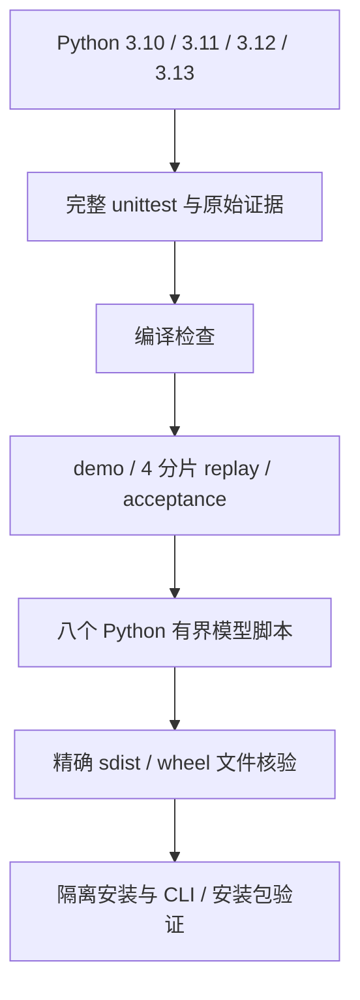

# 验证、可复算案例与证据边界

## 持久化模拟系统

运行 `python -m uta scenario --shards 4` 可验证开仓、撤单、持久化清算成交、残余债务与重开数据库重放。集成测试覆盖并发订单的版本冲突、限价和过期检查、FIFO 部分成交和反向开仓、同币种资产与负债导入、批量保存点、命令重试及 HTTP 退避。

`tests/test_portfolio.py` 检验压力损失独立手算、组合对冲、结算币不变性，并测试 240 组仓位变化是否遵守 IM 上界。已完成的性能测量及其负载限制见 [性能测试](performance.md)。

| 主链路性质 | 可检查的证据 | 证据边界 |
| --- | --- | --- |
| 六场景抵押品、负债、持仓联合重估及 IM/MM 底线 | [test_portfolio.py](../tests/test_portfolio.py)，[PM 手算](risk-model.md) | 项目自定义场景；没有外部交易所结果校准 |
| 经典账户导入、总资产与借款分别保留、冻结余额拒绝 | [test_shadow_adapter.py](../tests/test_shadow_adapter.py)、[test_simulator.py](../tests/test_simulator.py) | 导入是新模拟账户创世，不证明来源接口构成原子快照 |
| 独立连接争抢相同账户版本，审计失败时状态回滚 | [test_store.py](../tests/test_store.py) | 本地 SQLite 并发与故障注入；未覆盖断电或跨主机共识 |
| FIFO 部分成交、反向开仓、撤单和清算分录 | [test_simulator.py](../tests/test_simulator.py) | 人工注入成交与固定滑点，未接入真实撮合 |
| 重开数据库后的命令幂等、记录时间回放和快照比较 | [test_store.py](../tests/test_store.py)、[test_simulator.py](../tests/test_simulator.py) | 兼容当前模型和命令历史，不是外部会计真实性证明 |
| 分片路由固定、丢失分片拒绝、组提交保存点与分片独立失败 | [test_store.py](../tests/test_store.py) | 无跨分片原子事务或在线重新分片 |
| HTTP 信封、同源校验、批量逐项回执与过载退避 | [test_server.py](../tests/test_server.py) | 本机 HTTP 测试，不证明互联网服务鉴权或持续容量 |

## 本地与 CI 验证路径

在仓库根目录依次运行：

```bash
python -m unittest discover -s tests -v
python -m uta demo
python -m uta scenario --shards 4
python formal/explore_reservation.py
```

上面四条是贡献基础检查。当前 [CI 工作流](../.github/workflows/ci.yml) 在 Python 3.10–3.13 各自运行。`tools/run_validation.py` 包装完整 unittest，保留原始日志与结果；测试证据上传使用 `always()`，失败后的编译、情景和打包步骤仍会跳过。CI 还包含编译、合成 acceptance、八个 Python 有界模型脚本、精确 sdist/wheel 文件核验及源码目录之外的安装/CLI 验证：



额外源码检查命令为 `python -m compileall -q uta formal tests`、`python -m uta acceptance`，以及 formal 下 reservation、settlement、group_commit、shard_admission、durable_commands、managed_authority、market_epochs、durable_batches 各自的 `explore_*.py` 入口。安装验证还运行安装包的 demo、acceptance、scenario 和 CLI，初始化、inspect、status 一个新的 managed 目录，并核对精确包清单与隔离安装行为；完整顺序以工作流为准。

本地单一 Python 版本通过，不等于整个 CI 矩阵已通过。`scenario` 未指定数据库时使用临时目录并清理；要保存并再次回放，使用 [流程文档](workflows.md) 中带 `--db` 的命令。Python 枚举器与 TLA+ TLC 是不同工具；当前 CI 没有执行 TLC，范围见 [形式化模型说明](../formal/README.md)。

## 可选持久账本回放的首错顺序

`DurableLedger.verify` 的逐事件默认路径和显式 `ordered_postings` 试验必须保留相同的金融校验及首个错误。Python 3.10 的游标预取可提前解释未来 TEXT；仅按组计数并不足以隔离这个边界。当前候选将标准 UTF-8 试验载荷投影为带原类型的字节，按当前事件解码，其他编码/factory 使用原路径。完整流程、原失败及性能证据的适用范围见 [预取与解码边界](history-postings-error-order.md)，可运行 [test_history_postings_stream.py](../tests/test_history_postings_stream.py)。该变更保持默认关闭，不缓存验证结果，不代表启动、性能或生产验收通过。

## 认证链路的 SQLite 锁回归

认证交易链路使用 `uta.storage.Database`，与上面的研究模拟器 Store 分开。[test_storage_locks.py](../tests/test_storage_locks.py) 对普通库、分片库与认证 nonce 库分别验证：同进程打开和关闭第二个连接时，原读事务持有的 SQLite POSIX 文件锁不能消失。独立子进程直接探测实际锁，不以线程内互斥或最终余额相等代替锁证据。原文件检查会额外打开并关闭已有数据库，三个入口均可触发该回归；实现已改为无额外描述符的文件元数据检查。

时序图、运行命令、SQLite 版本差异及未验证边界见 [SQLite 文件检查与进程锁](storage-locks.md)。该项通过不等于持续容量、断电恢复或跨主机验收通过。

## 验证问题和证据

下表描述基础模块中可重复运行的测试范围，不能证明交易所真实规则、市场数据正确性或生产安全。运行 `python -m unittest discover -s tests -v` 获得当次结果；在 CI 中查看具体提交的运行记录。不同模块的测试不等于端到端系统验收。

| 性质或问题 | 证据 | 当前边界 |
| --- | --- | --- |
| 正资产折扣、负余额、线性合约损益与固定费率保证金 | `tests/test_risk.py` 和下方手算 | 简化模型；输入新鲜度由调用方负责，暂无交易所实盘对账 |
| 固定案例与订单结果的差分计算 | `tests/test_reference_validation.py` 中黄金案例及固定随机种子的 500 组样例，参考计算使用有理数 | 参考实现和主实现基于同一项目假设；结果一致不能证明模型等同交易所规则 |
| 输入缺失、不合法值 | 风险、镜像、API 测试 | 不代表所有源头故障均已检测 |
| 镜像版本、重试、数据字段完整性 | `tests/test_migration.py` | 不保证不同来源接口构成原子快照，本行验证独立镜像。另见模拟器导入及 PM 集成验证 |
| 清算撤单、再评估、动作确认、过期快照 | `tests/test_liquidation.py` | 内存状态机；无实际执行、成交、重启恢复和跨进程幂等 |
| 每个资产的分录平衡、幂等与按序重放 | `tests/test_ledger.py` | 内存账本允许负余额，不提供真实结算或授信约束 |
| 同进程内重复占用 | `tests/test_reservations.py` 的多线程竞争 | 基于进程内锁；不验证跨进程、数据库隔离或交易网关的原子性 |
| API 示例和错误输入 | `tests/test_api.py` | 仅本机无认证演示；不是生产 API |

尚未取得的证据包括真实交易所逐字段对账、第三方独立审计、真实行情历史回放、连续端到端压力验收、业务参数校准、进程崩溃/断电与跨主机故障恢复、形式化证明覆盖真实实现及监管适用性审查。现有有界模型只覆盖 [公开的假设与状态空间](../formal/README.md)，不能把规格文件存在、Python 枚举通过或数据库重开成功描述为这些目标已完成。

## 独立日记簿的精度与回放

[Ledger](../uta/ledger.py) 按币种小数位转换为整数最小单位，`unit_digits` 指定这些整数的位数上限，默认 38，可显式设为 38–60。每笔金额和累计余额的绝对值均须小于 `10 ** unit_digits` 个最小单位；该参数控制范围，金额仍须精确匹配币种小数位，不进行舍入。

`JournalEvent` 不携带币种小数位或位数上限，调用方须随历史保留这两项配置。对显式使用较宽上限的日记簿，回放时提供相同 `unit_digits`；省略时仍执行默认 38 位检查。例如 USD 保留 18 位小数时，下面的金额对应 `10 ** 43` 个最小单位，需要较宽配置：

```python
from decimal import Decimal as D
from uta.ledger import Ledger, Posting

scales = {"USD": 18}
ledger = Ledger(scales, unit_digits=60)
ledger.post("large", [Posting("external", "USD", D("-1e25")),
                      Posting("customer", "USD", D("1e25"))])
restored = Ledger.replay(scales, ledger.journal(), unit_digits=60)
assert restored.balance("customer", "USD") == D("1e25")
```

[test_ledger.py](../tests/test_ledger.py) 覆盖较宽金额与最小单位扣减的精确往返、低 Decimal 精度上下文、回放后的幂等、默认范围拒绝，以及回放后新增事件触发余额上限时不改变余额或历史。这里重建的是独立内存日记簿；SQLite 账户的逐命令回放由 [Simulator.verify_replay](../uta/simulator.py) 完成，流程见 [审计回放](workflows.md)。

## 可人工复算的基准

此例对应 `test_collateral_liability_unrealized_pnl_and_margins`，所有数值均为合成示例，不对应任何交易所参数。报告单位为 USD，合约乘数假设为 1。

输入：持有 1 BTC，价格 100 USD，抵押系数 0.8；USD 净余额 -10；BTC 线性永续多头 2，开仓价 80，标记价 100；初始保证金率 10%，维持保证金率 5%；现有订单占用 3。

| 计算 | 算式 | 结果（USD） |
| --- | --- | ---: |
| 折扣后 BTC 资产 | 1 × 100 × 0.8 | 80 |
| USD 负余额 | -10 × 1 | -10 |
| 未实现损益 | 2 × (100 − 80) | 40 |
| 折扣后权益 | 80 − 10 + 40 | 110 |
| 初始保证金 | 2 × 100 × 10% | 20 |
| 维持保证金 | 2 × 100 × 5% | 10 |
| 可用保证金 | 110 − 20 − 3 | 87 |
| 示例保证金比率 | 110 ÷ 10 | 11 |

该比率不是任何交易所的 UniMMR 或其相反数。模型支持分别输入同币种资产和负债，但借款利息须由调用方作为负债输入；它不自动产生利息、资金费或现金流变动。

## 主链路与独立示例的失效场景

| 失效场景 | 当前处理或缺口 |
| --- | --- |
| 价格缺失、非法数值 | 风险函数拒绝缺失配置和非法数值；模拟器行情更新要求完整产品集合。纯计算函数不检查时效，所有路径均不认证外部价格来源。 |
| 镜像采集并非原子 | 源适配器负责提供一致快照；跨接口数据一致性未经保证。 |
| 清算数据过期或时间倒退 | 持久化模拟器拒绝过期下单、成交及单独清算，允许撤单或刷新报价；独立控制器还有自己的完整性与严格更新检查。 |
| 并发订单 | 主链路的版本、PM、预占和接单在同一 SQLite 写事务内；独立 `ReservationBook` 仅提供进程内锁，`check_order` 本身无原子接单能力。 |
| 服务重启、网络分区或多副本 | 主链路保存快照、命令和清算回执，已验证重开与回放；独立镜像、预留簿和清算控制器仍在内存中。跨主机复制、网络分区和崩溃恢复未验收。 |
| 掉单、撤单结果未知、部分成交 | 主链路支持模拟部分成交及原请求恢复已提交回执；交易台没有持久化重试队列，且所有路径均未连接真实执行系统。 |
| 清算成交已完成但权益仍为负 | 保留 USD 负债，可出现仓位清零但 `health=INSOLVENT`；没有保险基金或 ADL，不能把处置完成解释为偿付能力恢复。 |
| API 被公网访问 | 两套本地 HTTP 服务均无用户身份认证；模拟器的 Host/Origin 检查不能替代鉴权，不能通过代理当作生产服务暴露。 |
| 客户数据、密钥泄露 | 不提供凭据存储；公开测试必须使用合成或获授权脱敏数据，不能提交密钥。 |

## 官方一手资料与适用性

以下仅用于确认官方公开的账户模式、字段或监管背景，**不是本项目公式的来源证明或兼容性认证**。读取时应记录访问日期、适用产品和账户版本，并对文档变更重新核验。

- [Binance Portfolio Margin 账户接口](https://developers.binance.com/zh-CN/docs/catalog/advanced-trading-derivatives-trading-portfolio-margin/api/rest-api/account)：公开账户状态及风险字段。
- [Binance Portfolio Margin 交易接口](https://developers.binance.com/zh-CN/docs/catalog/advanced-trading-derivatives-trading-portfolio-margin/api/rest-api/trade)：文档提示部分风险清算调整不出现在指定强平记录接口，不能单靠一个接口重建全部事件。
- [Bybit 账户模式](https://bybit-exchange.github.io/docs/v5/acct-mode)：不同账户模式的产品和保证金边界存在差异。
- [Bybit 抵押品信息](https://bybit-exchange.github.io/docs/v5/account/collateral-info)：账户抵押资格、转换率等信息。
- [CFTC 清算机构说明](https://www.cftc.gov/IndustryOversight/ClearingOrganizations/index.htm)：监管背景参考，不表明本原型取得任何许可或适用于该制度。
