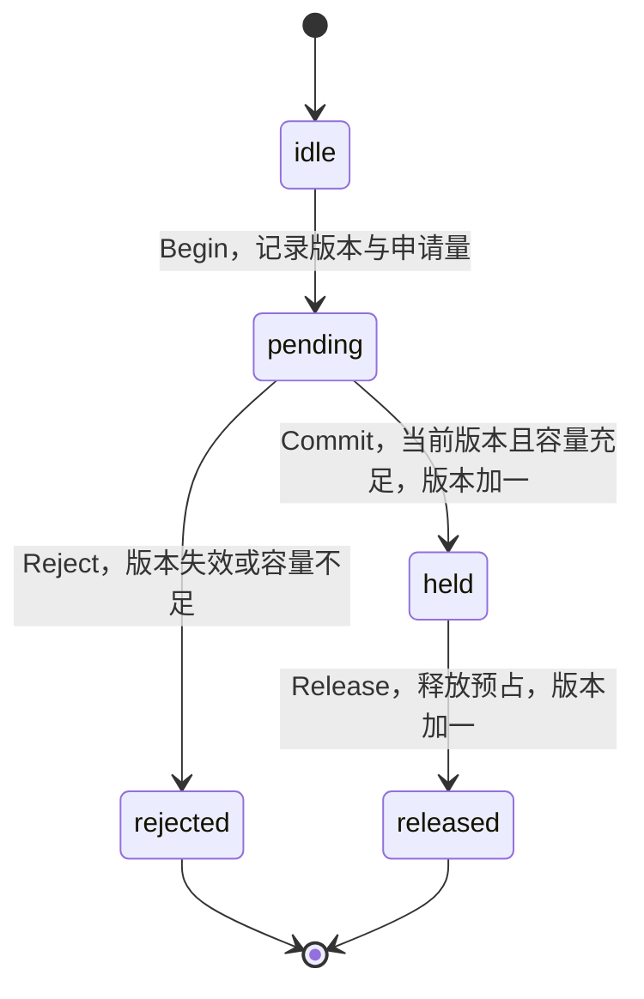

# 保证金预占的有界状态模型

`Reservation.tla` 抽象三个订单对同一固定容量的并发请求。每个请求先读取版本，再原子校验当前版本和剩余容量并预占；释放后版本递增。不同订单可以同时进入 pending，但只有基于当前版本的请求可以提交。模型检查配置断言类型正确、总预占不超过容量，且仅 held 状态持有与请求量相等的预占。

## 订单状态与原子操作



状态与守卫对应 [Reservation.tla](Reservation.tla) 的 `Begin`、`Commit`、`Reject`、`Release`。`rejected` 与 `released` 是单次生命周期的终态；图中未画出的停滞步由 `[][Next]_vars` 允许。它不是持久化模拟器的订单状态图，后者见 [订单生命周期](../docs/workflows.md)。

| 不变量 | 含义 |
| --- | --- |
| `TypeOK` | 阶段、数量、预占和版本均在模型规定的类型范围内 |
| `NoOvercommit` | 所有订单预占总和不超过固定 Capacity |
| `HeldMatchesReservation` | held 的预占等于申请量且为正，其他状态无预占 |

示例运行（须自行安装官方 `tla2tools.jar`，仓库不附带该文件）：

```sh
java -XX:+UseParallelGC -cp /path/to/tla2tools.jar tlc2.TLC -deadlock -workers 1 -config formal/Reservation.cfg formal/Reservation.tla
python formal/explore_reservation.py
```

## 范围与边界

- TLC 配置仅检查三个订单、容量为 2 的有限状态空间，不代表对任意规模、全部历史或生产实现的数学证明。已在下述限定条件运行 TLC；结果不证明生产实现与规格等价。
- `explore_reservation.py` 是独立的 Python 有限状态枚举器，对同样的抽象进行安全性质检查；它不是 TLC、TLA+ 语法检查器，也不能证明该 Python 模型与 TLA+ 或生产代码语义等价。
- 安全性依赖于版本检查、余额检查、状态和版本更新在同一原子操作中完成；这些原子性假设不能由此模型对外部数据库自动保证。
- 容量固定，订单数量有限，一次订单 ID 只进入一次生命周期；模型不包含持久化、数据库隔离、交易所执行、事件交付、价格更新、费用、金额精度、业务幂等键冲突或抵押品变化。
- `[][Next]_vars` 允许停滞，无公平性或最终完成保证；这只检查安全性，并不证明活性。
- 对比模型会故意错误地采用申请时记录的余量且不验证版本，枚举器打印可复现的超额预占反例；它是反例演示，不是对真实实现的漏洞指控。

## TLC 首次实际验证与终态说明

验证对象为 PR #3 基线 `92086bd8fbd1d41427a614dfdd60dce183396258` 的未修改 `Reservation.tla` 与 `Reservation.cfg`。使用官方 [TLA+ v1.7.4 发布包](https://github.com/tlaplus/tlaplus/releases/tag/v1.7.4) 的 `tla2tools.jar`（TLC 2.19，rev `5a47802`），Java 21.0.13、Linux x86_64、单 worker。JAR SHA-256：`936a262061c914694dfd669a543be24573c45d5aa0ff20a8b96b23d01e050e88`。

原命令启用默认 deadlock 检查，会在所有订单均已 released/rejected、无后续 Next 动作时报告 `Deadlock reached`。这次运行没有完成全图探索，不能报告为通过。此模型是单次有限订单生命周期，允许终态停滞；上面的 `-deadlock` 参数**禁用 deadlock 检查**，仅用于穷尽既有安全不变量，不是修复或证明生产系统不会死锁。

明确禁用 deadlock 检查后，TLC 退出码为 0，报告 `Model checking completed. No error has been found.`；4,198 个生成状态、2,628 个不同状态、队列剩余 0、图深度 10。检查的是配置中的 `TypeOK`、`NoOvercommit` 和 `HeldMatchesReservation`。不包含活性、最终成交、外部故障、任意订单规模或真实金融授权。
